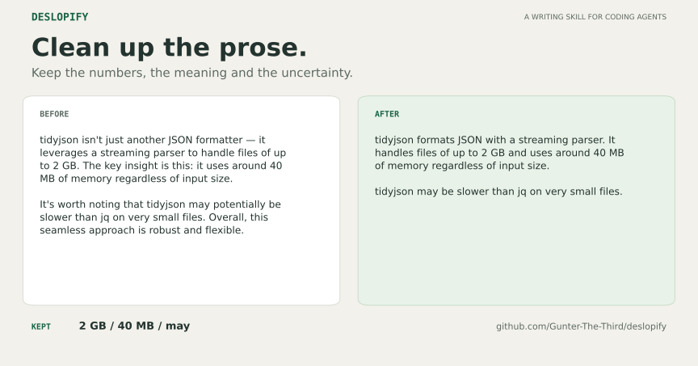

# Deslopify

Clean up AI-sounding READMEs, PR descriptions and papers. Keep the author's
voice, numbers, citations and uncertainty.

[](https://github.com/Gunter-The-Third/deslopify/actions/workflows/checks.yml)

[MIT](LICENSE) · [Examples](evals/EXAMPLES.md) · [Install](#install) ·
[Try the demo](#try-the-demo-without-a-model)



The demo keeps both numbers and the uncertainty. The agent removes the padded
framing. [Read the original](evals/cases/quick-demo/before.md) and
[the rewrite](evals/cases/quick-demo/after.md), or run the checks below.

For a longer comparison, read [real Claude Opus output at three editing
levels](evals/examples/opus-longform/README.md). It includes the untouched
article, light, standard and maximum edits, the prompts and the model's
response metadata. Each pass starts from the same source.

## Install

In Claude Code:

```text
/plugin marketplace add Gunter-The-Third/deslopify
/plugin install deslop@deslop
```

Then run:

```text
/deslop:deslop README.md
```

The scanner and verifier need Python 3.8+ and use only the standard library.
Deslopify works with Markdown, LaTeX, reStructuredText and plain text.

<details>
<summary>Install personal skills for short command names</summary>

```bash
git clone https://github.com/Gunter-The-Third/deslopify.git
mkdir -p ~/.claude/skills
cp -r deslopify/skills/deslop deslopify/skills/deslopmax deslopify/skills/deslopchinese ~/.claude/skills/
```

Keep the skill folders together because the maximum mode uses the shared
workflow and scripts. Other coding agents can read
[`skills/deslop/SKILL.md`](skills/deslop/SKILL.md) from the checkout.

</details>

## Choose a pass

| Plugin command | Personal skill command | What it does |
|---|---|---|
| `/deslop:deslop FILE` | `/deslop FILE` | Small sentence edits. |
| `/deslop:deslop FILE light` | `/deslop FILE light` | Obvious wording fixes, keeping paragraph order and structure. |
| `/deslop:deslop FILE review` | `/deslop FILE review` | Findings and suggested rewrites. |
| `/deslop:deslopmax FILE` | `/deslopmax FILE` | Also restructure padded paragraphs and repeated caveats. |

Both editing modes preserve facts and qualifications, and leave clear prose
alone. You can also append `max` to the ordinary command. The older
`deslopchinese` command remains an alias for the maximum pass.
[Claude Code namespaces plugin commands](https://code.claude.com/docs/en/skills#choose-where-skills-load).

## Try the demo without a model

Clone the repo and run the scanner on the original and rewrite:

```bash
git clone https://github.com/Gunter-The-Third/deslopify.git
cd deslopify
python3 skills/deslop/scripts/slopscan.py evals/cases/quick-demo/before.md --compact
python3 skills/deslop/scripts/slopscan.py evals/cases/quick-demo/after.md --compact
python3 skills/deslop/scripts/factdiff.py evals/cases/quick-demo/before.md evals/cases/quick-demo/after.md
```

This checks the included rewrite. To test your agent, ask it to deslop a copy
of the original and compare that copy with the source. `factdiff` checks
extracted numbers, citations, references, URLs, quotations, code and maths,
including occurrence counts. Read the prose diff to check meaning, units,
names and claim strength.

## How it edits

1. Scan the named prose and locate repeated sentence frames, signposting,
   stock vocabulary, stacked hedges and other patterns.
2. Read the hits in context. Keep legitimate contrasts, technical terms and
   punctuation that helps the reader.
3. Make the smallest useful changes. In maximum mode, also remove repetition
   across paragraphs and gather repeated caveats without weakening them.
4. Re-scan, check protected tokens and read the diff for meaning.

With an [author baseline](baselines/README.md), the scanner compares each
feature with the author's own earlier writing. That helps preserve habitual
connectives and patterns such as lists of three. Without a baseline, it uses
rough built-in ceilings. The rules and examples live in
[`skills/deslop/rules/`](skills/deslop/rules/).

The main instructions load only the rules needed for the task. Targets are
scanned together and compact reports omit repeated snippets. The
[recorded examples](evals/EXAMPLES.md) show instruction and output sizes.
Actual token use depends on the model and input.

<details>
<summary>Use the scripts directly</summary>

```bash
# List every hit with its context
python3 skills/deslop/scripts/slopscan.py docs/ --list

# Focus on one pattern
python3 skills/deslop/scripts/slopscan.py paper.tex --list --feature em_dash

# Use the author's saved rates
python3 skills/deslop/scripts/slopscan.py paper.tex --baseline baselines/author.json --compact

# Fail CI when excess over the ceilings is too high
python3 skills/deslop/scripts/slopscan.py docs/ --fail-above 2.0

# Compare a working file with its committed version
python3 skills/deslop/scripts/factdiff.py --git HEAD README.md
```

</details>

## Checks and limits

```bash
python3 evals/run_evals.py
```

The suite covers the demo, three longer reference rewrites, two clean samples
and 34 regression tests, including the saved Opus comparison. [Example
outputs](evals/EXAMPLES.md) include a README,
a PR description and a LaTeX results section. To evaluate an agent, save its
`candidate.md` or `candidate.tex` beside a case's `before` file and re-run the
suite. Candidates must score lower, keep protected tokens and be no more
than 5% longer.

The scanner measures English patterns, not authorship. Hits need a reader,
and rates on short texts are noisy. Other languages need a reading pass.
`factdiff` cannot establish that a rewrite kept its meaning. The small eval
set does not establish a detection rate or general model performance.

Found a missed pattern, a false positive or an edit that lost meaning?
[Open an issue](https://github.com/Gunter-The-Third/deslopify/issues) with a
short example and the result you expected.

[Demo artwork and launch copy](docs/SHARING.md) are available for sharing.
